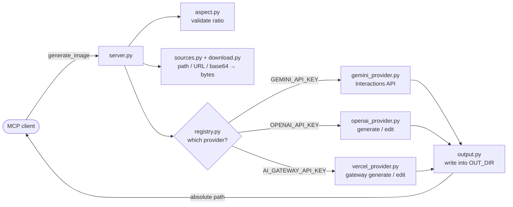

<p align="center">
  
</p>

<h1 align="center">image-generation-mcp</h1>

<p align="center">
  <strong>Give any MCP-capable agent the ability to draw.</strong><br>
  One tool, three providers, zero image bytes in your context window.
</p>

<p align="center">
  <a href="https://modelcontextprotocol.io"></a>
  <a href="https://www.python.org/downloads/"></a>
  <a href="#providers"></a>
  <a href="https://github.com/astral-sh/ruff"></a>
  <a href="https://mypy-lang.org/"></a>
  <a href="#development"></a>
  <a href="LICENSE"></a>
</p>

---

Ask your agent for a picture, and it gets back a file path — not a wall of base64.
The server generates the image with **Gemini**, **OpenAI**, or any image model on the
**Vercel AI Gateway** (Flux, Grok Imagine, Recraft, Seedream, …), writes it to disk, and
returns only the absolute path. Your context window stays clean, and the file is
right there for the agent to open, move, or hand to another tool.

<p align="center">
  
</p>

## Features

- **One tool, no ceremony.** `generate_image(prompt, images, aspect_ratio)` — that's the whole API.
- **Paths, not payloads.** Returns an absolute file path, so a 1.5 MB PNG costs you ~60 tokens instead of ~2 million.
- **Three providers, auto-selected.** Set whichever API key you have. Several set? `IMAGE_PROVIDER` decides.
- **Dozens of models through one key.** The Vercel AI Gateway provider reaches Flux, Grok Imagine, Recraft, Seedream, and OpenAI image models — from $0.007 per image.
- **Image-to-image.** Pass up to 4 reference images to restyle, edit, or combine them.
- **Flexible inputs.** A reference can be a local path, an `http(s)` URL, a `data:` URI, or bare base64 — the server figures out which.
- **Both transports.** stdio for local clients, streamable HTTP (localhost-bound) when you need a port.
- **Honest errors.** No retries that mask a bad key, no silent provider fallback. When the API says 429, you see 429.
- **Small enough to read.** ~620 lines of source, no file over 100 lines, strict-typed throughout.

## Prerequisites

| Requirement | Notes |
| --- | --- |
| **Python 3.11+** | 3.12 is what CI-equivalent local checks run on |
| **[uv](https://docs.astral.sh/uv/)** | `curl -LsSf https://astral.sh/uv/install.sh \| sh` |
| **An API key** | Google Gemini, OpenAI, **or** Vercel AI Gateway — at least one |

> **Billing note.** Image models are not free tier on Gemini or OpenAI. A Gemini key
> without billing enabled returns `429 ... limit: 0` for every image model. Vercel AI
> Gateway bills per image from your gateway credits — see [pricing](#vercel-ai-gateway-pricing).

## Quick Start

```bash
git clone https://github.com/farukcan/image-generation-mcp.git
cd image-generation-mcp
uv sync

cp .env.example .env      # add GEMINI_API_KEY, OPENAI_API_KEY, or AI_GATEWAY_API_KEY
uv run pytest -m smoke    # generates a real image into out/
```

That last command is the fastest way to confirm your key works end to end — it
prints the path of the image it just made.

## Add it to your agent

### Claude Code

```bash
claude mcp add image-generation \
  -e OPENAI_API_KEY=sk-... \
  -- uvx --from git+https://github.com/farukcan/image-generation-mcp image-generation-mcp
```

`uvx` fetches, builds, and caches the package on first run — there is nothing to
install beforehand and nothing to keep updated by hand.

Prefer a checkout you can edit? Point it at the directory instead:

```bash
claude mcp add image-generation \
  -e OPENAI_API_KEY=sk-... \
  -- uv run --directory /absolute/path/to/image-generation-mcp image-generation-mcp
```

Add `-s user` to make it available in every project instead of just this one.
Verify with `claude mcp list`, and remove it with `claude mcp remove image-generation`.

### Gemini CLI

Same flags, same shape:

```bash
gemini mcp add image-generation \
  -e OPENAI_API_KEY=sk-... \
  -- uvx --from git+https://github.com/farukcan/image-generation-mcp image-generation-mcp
```

### Cursor, Windsurf, Claude Desktop, and everything else

These read a JSON config file (`.cursor/mcp.json`, `claude_desktop_config.json`, …).
The entry is the same everywhere:

```json
{
  "mcpServers": {
    "image-generation": {
      "command": "uvx",
      "args": [
        "--from", "git+https://github.com/farukcan/image-generation-mcp",
        "image-generation-mcp"
      ],
      "env": {
        "OPENAI_API_KEY": "sk-...",
        "OUT_DIR": "/absolute/path/where/images/should/land"
      }
    }
  }
}
```

Set `OUT_DIR` explicitly for GUI clients — they often launch with a working
directory you did not expect, and `out/` would land there.

### As an HTTP service

```bash
uv run image-generation-mcp --transport http --port 8000
```

Serves the streamable-HTTP endpoint at `http://127.0.0.1:8000/mcp`. It binds to
loopback only and has no authentication, so put it behind a proxy before exposing it.

## The tool

```python
generate_image(prompt: str, images: list[str] | None = None, aspect_ratio: str = "1:1") -> str
```

| Parameter | Description |
| --- | --- |
| `prompt` | What the image should show. |
| `images` | Up to 4 reference images. Each is a local file path, an `http(s)://` URL (30 s timeout, streamed and aborted past 20 MB), a `data:` URI, or bare base64. An existing file always wins; otherwise a base64-shaped string is decoded as such. |
| `aspect_ratio` | `1:1`, `2:3`, `3:2`, `3:4`, `4:3`, `4:5`, `5:4`, `9:16`, `16:9`, `21:9`. |

Returns the absolute path of the written file, e.g. `/path/to/out/20260827-172746-c9b3.png`.
Names are `YYYYmmdd-HHMMSS-xxxx`, so results sort chronologically and never collide.

**On aspect ratios:** Gemini honours all ten. OpenAI accepts only three sizes, so
ratios collapse to the nearest of `1024x1024`, `1536x1024`, or `1024x1536` — asking
for `16:9` there gets you 3:2. Vercel AI Gateway gets the same three sizes (its Images
endpoint does not forward an aspect ratio field, and OpenAI models behind it reject any
other size). Flux honours them; some models, such as Grok Imagine, ignore `size` and
pick their own shape.

## Configuration

Every setting is an environment variable. A `.env` file in the working directory (or
any parent) is loaded as a fallback; real environment variables always win.

| Variable | Default | Purpose |
| --- | --- | --- |
| `GEMINI_API_KEY` | — | Enables the Gemini provider |
| `OPENAI_API_KEY` | — | Enables the OpenAI provider |
| `AI_GATEWAY_API_KEY` | — | Enables the Vercel AI Gateway provider |
| `IMAGE_PROVIDER` | unset | Force `gemini`, `openai`, or `vercel`. Unset means Gemini, then OpenAI, then Vercel |
| `GEMINI_IMAGE_MODEL` | `gemini-3.1-flash-image` | Also `gemini-3-pro-image`, `gemini-3.1-flash-lite-image` |
| `OPENAI_IMAGE_MODEL` | `gpt-image-2` | Also `gpt-image-1.5`, `gpt-image-1`, `gpt-image-1-mini` |
| `VERCEL_IMAGE_MODEL` | `bfl/flux-3-image-klein` | Any image-only gateway model, e.g. `spacexai/grok-imagine-image`, `openai/gpt-image-1-mini` |
| `OUT_DIR` | `<cwd>/out` | Where generated images are written |
| `MCP_TRANSPORT` | `stdio` | `stdio` or `http`; `--transport` overrides it |
| `MCP_PORT` | `8000` | HTTP port; `--port` overrides it |

Start the server with no API key at all and the first request fails loudly, naming
the variables it looked for.

## How it works



Each module does one thing and stays under 100 lines. Providers are cached per
resolved config, so an SDK client and its connection pool are reused across calls
rather than rebuilt every request.

## Providers

| | Gemini | OpenAI | Vercel AI Gateway |
| --- | --- | --- | --- |
| API | Interactions (`client.aio.interactions.create`) | Images (`images.generate` / `images.edit`) | OpenAI-compatible Images at `https://ai-gateway.vercel.sh/v1` |
| SDK floor | `google-genai >= 2.3.0` | `openai >= 3.0.0` | `openai >= 3.0.0` |
| Reference images | Sent inline as base64 parts | Uploaded as multipart files | Uploaded as multipart files (PNG, JPEG, GIF, BMP, or WebP); the gateway rejects what the model cannot take |
| Output format | Whatever the model returns — the extension follows it | Always PNG (`output_format="png"`) | Whatever the model returns (JPEG, PNG, WebP), read from the bytes |

Deliberate quirks worth knowing:

- Gemini's image `response_format` only accepts `image/jpeg` as an explicit MIME
  type, so the server does not request one and names the file after whatever comes back.
- `input_fidelity` is never sent to OpenAI — `gpt-image-2` rejects it with a 400 and
  applies high fidelity on its own.
- The Vercel provider covers **image-only** gateway models. Multimodal models that
  generate images through chat completions (Gemini "Nano Banana", GPT-5) are not wired
  up; use the Gemini or OpenAI provider for those.
- Not every gateway model edits. A model without image input fails reference-image
  calls with the gateway's own error — there is no silent fallback.

### Vercel AI Gateway pricing

The default, `bfl/flux-3-image-klein`, is the cheapest model we found that both
honours `size` and edits faithfully. Spot checks on 2026-11-03, one bicycle prompt each:

| Model | Generate | Edit | `size` honoured | Notes |
| --- | --- | --- | --- | --- |
| `bfl/flux-3-image-klein` | ✅ | ✅ | ✅ | Default. Sharp, coherent, ~7 s |
| `spacexai/grok-imagine-image` | ✅ | ✅ | ❌ | Picks its own shape |
| `meta/muse-image-1.0` | ✅ | ✅ | not tested | Returns WebP |
| `recraft/recraft-v4.1-flash` | ✅ | not tested | not tested | Returns WebP |
| `bytedance/seedream-4.0` | ✅ | not tested | not tested | Stamps an "AI generated" watermark |

<details>
<summary>All image models and their prices</summary>

Source: `GET https://ai-gateway.vercel.sh/v1/models`, fetched 2026-11-03. Prices are USD
and change — check the [model list](https://vercel.com/ai-gateway/models?type=image)
before relying on them.

Billed per image (the price is for the default size unless a tier is listed):

| Model | Per image | Other tiers |
| --- | --- | --- |
| `recraft/recraft-v4.1-flash` | $0.007 | — |
| `bfl/flux-3-image-klein` | $0.009 | 768x768 $0.008, 1024x1024 $0.009, 1536x1536 $0.011, 2048x2048 $0.014, 4096x4096 $0.036 |
| `meta/muse-image-1.0` | $0.01 | — |
| `spacexai/grok-imagine-image` | $0.02 | — |
| `recraft/recraft-v2` | $0.022 | vector illustration $0.044 |
| `bytedance/seedream-4.0` | $0.03 | — |
| `bytedance/seedream-5.0-lite` | $0.035 | — |
| `bytedance/seedream-5.0-pro` | $0.035 | — |
| `recraft/recraft-v4.1` | $0.035 | vector illustration $0.08 |
| `recraft/recraft-v4.1-utility` | $0.035 | vector illustration $0.08 |
| `bfl/flux-kontext-pro` | $0.04 | — |
| `bfl/flux-pro-1.1` | $0.04 | — |
| `bytedance/seedream-4.5` | $0.04 | — |
| `recraft/recraft-v3` | $0.04 | vector illustration $0.08 |
| `recraft/recraft-v4` | $0.04 | vector illustration $0.08 |
| `bfl/flux-3-image` | $0.048 | 768x768 $0.041, 1024x1024 $0.048, 1536x1536 $0.07, 2048x2048 $0.1, 4096x4096 $0.607 |
| `bfl/flux-pro-1.0-fill` | $0.05 | — |
| `bfl/flux-pro-1.1-ultra` | $0.06 | — |
| `spacexai/grok-imagine-image-2.0` | $0.06 | low $0.04, 2048x2048 $0.08, low 2048x2048 $0.06 |
| `bfl/flux-kontext-max` | $0.08 | — |
| `recraft/recraft-v4.1-pro` | $0.21 | vector illustration $0.3 |
| `recraft/recraft-v4.1-utility-pro` | $0.21 | vector illustration $0.3 |
| `recraft/recraft-v4-pro` | $0.25 | vector illustration $0.3 |

Billed per token (cost per image depends on size and quality):

| Model | Input / 1M tokens | Output / 1M tokens |
| --- | --- | --- |
| `openai/gpt-image-1-mini` | $2 | $8 |
| `microsoft/mai-image-2.6-flash` | $1.75 | $19 |
| `openai/gpt-image-2` | $5 | $30 |
| `openai/gpt-image-2.5-flare` | $5 | $30 |
| `openai/gpt-image-2.5-sunburst` | $5 | $30 |
| `openai/gpt-image-1.5` | $5 | $32 |
| `microsoft/mai-image-2.6` | $5 | $38 |

No price listed: `bfl/flux-2-flex`, `bfl/flux-2-klein-4b`, `bfl/flux-2-klein-9b`,
`bfl/flux-2-max`, `bfl/flux-2-pro`, `prodia/flux-fast-schnell`, `topaz/wonder-3.5`.

</details>

## Development

```bash
uv run ruff check . && uv run ruff format --check .
uv run mypy
uv run pytest              # unit tests, all providers mocked
uv run pytest -m smoke -s  # real API calls; costs money, prints the paths
```

Smoke tests are deselected by default so a normal `pytest` run never spends money.
`test_edits_a_real_image` costs two generations, since it makes its own reference image.
`test_vercel_generates_and_edits` forces the Vercel provider and also costs two
generations on `VERCEL_IMAGE_MODEL` (about $0.02 on the default).

The logo and the screenshot are generated too — edit the scripts, not the SVGs:

```bash
uv run python media/generate_logo.py
uv run python media/generate_screenshot.py
```

The 100-line-per-file ceiling is a design constraint, not an accident: it keeps every
module reviewable in one screen. Split rather than stretch.

## Troubleshooting

| Symptom | Cause |
| --- | --- |
| `429 ... limit: 0` | The model is not on your plan's free tier. Enable billing on the provider project. |
| `RuntimeError: No API key configured` | No key is set, and no `.env` was found from the working directory upward. |
| Images appear somewhere unexpected | `OUT_DIR` is unset and the client launched the server from a different directory. Set it explicitly. |
| `Unsupported aspect_ratio` | Only the ten listed ratios are accepted; the error lists them. |
| `reference images must be one of ...` | OpenAI takes PNG, JPEG, or WebP references only. |
| Vercel image has the wrong shape | The gateway model ignores `size` (e.g. Grok Imagine). Pick a model that honours it, such as the default Flux. |

## License

[MIT](LICENSE) © Ömer Faruk Can
